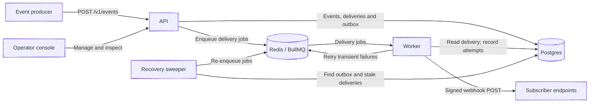

# Hikyaku

<p align="center">
  
</p>

Self-hosted, multi-tenant webhook delivery. Ingest an event once; the API fans it out to each active endpoint; the worker signs outbound HTTP with HMAC-SHA256, retries transient failures, and keeps attempt history in an operator console.

**Name:** 飛脚 (_hikyaku_) — Japan’s historic express couriers.

**Stack:** Node.js · Express · BullMQ · Postgres · Redis · Vite/React

**Repo:** [github.com/0x4Nayan04/Hikyaku](https://github.com/0x4Nayan04/Hikyaku) · **License:** [MIT](./LICENSE) · **Security:** [SECURITY.md](./SECURITY.md)

**Live demo:** [hikyaku.nayanswarnkar.com](https://hikyaku.nayanswarnkar.com) — public landing and docs. The operator console is invite-only (no self-serve signup). For a full console, follow [Local development](#local-development) below, or the [website](https://hikyaku.nayanswarnkar.com/docs#console-path) and [terminal](https://hikyaku.nayanswarnkar.com/docs#api-only-path) walkthroughs.

The demo configuration is **split**: web on Vercel, API + worker on Railway (`hikyakuapi.nayanswarnkar.com`). The proxy keeps session cookies on the Vercel origin. This describes repository configuration, not a live deployment check. **Self-host** with one-host Docker Compose — that is the supported path for your own install.

An optional [read-only console demo](deploy/README.md#read-only-console-demo) uses synthetic data and public credentials. Enable its login panel only after deploying enforcement and seeding the protected workspace.

**API reference:** [OpenAPI 3.1 source](docs/openapi.yaml) · [Published YAML](https://hikyaku.nayanswarnkar.com/openapi.yaml) (available after deploying this version). Sending events accepts an ingest API key; managing a workspace requires a session cookie. Production cookie mutations also require an allowlisted `Origin`.

## Architecture



The API stores each event, its deliveries, and their outbox entries in one Postgres transaction, then enqueues delivery jobs. The worker's sweeper recovers outbox entries and stale deliveries. Each active endpoint gets a separate delivery; receivers should deduplicate retries using `X-Webhook-Id`.

| Piece         | Role                                            |
| ------------- | ----------------------------------------------- |
| `apps/api`    | Auth, ingest, endpoints, deliveries, admin      |
| `apps/worker` | Signed outbound HTTP, retries, recovery sweeper |
| `apps/web`    | Landing, docs, operator console                 |
| Postgres      | Tenants, events, deliveries, attempts           |
| Redis         | BullMQ delivery queue                           |

## Local development

See the [in-app guide](http://localhost:5173/docs) for the console and terminal walkthroughs. Start local services with `pnpm dev` after configuring PostgreSQL and Redis.

## Demo path (first run)

Follow the [console walkthrough](http://localhost:5173/docs#console-path) after starting the local services.


## Send an event

Use the console or HTTP commands. Register receivers, send events, inspect deliveries, and retry failures without opening the console.

The API key only **sends** events. Adding endpoints, creating keys, and replay use the console **or** a signed-in terminal session — see the walkthrough at [http://localhost:5173/docs#api-only-path](http://localhost:5173/docs#api-only-path) after `pnpm dev`.

With an active endpoint and a key:

```bash
curl -X POST "http://localhost:3000/v1/events" \
  -H "Authorization: Bearer whk_your_api_key" \
  -H "Content-Type: application/json" \
  -d '{
    "idempotency_key": "order-123-paid",
    "type": "order.paid",
    "payload": { "order_id": "123", "amount": 4999 }
  }'
```

`202 Accepted` means the ingest was accepted, not that every delivery succeeded. The response includes the event `id`; if no endpoints are active, its status is `no_recipients` and no delivery is queued. If enqueue fails after the event is committed, the API can return `503` while the outbox still enables later delivery. Retry the same request with the same idempotency key and inspect the event before sending a new one.

## Deploy

**Self-host (your own install):** one-host Docker Compose (API + worker + Postgres + Redis + Caddy).
See **[deploy/README.md](deploy/README.md)** for setup, HTTPS, backups, and upgrades.

**Public demo:** web on Vercel, API + worker on Railway. Same file, [Optional: Vercel + Railway](deploy/README.md#optional-vercel--railway).

## Project layout

```
apps/api         REST API — auth, ingest, deliveries, admin
apps/worker      Delivery worker (BullMQ)
apps/web         Operator console + docs
packages/shared  Schema, env, crypto, shared types
e2e/             Playwright smoke tests
deploy/          Production Compose stack + ops notes
```

## Verification

Run `pnpm lint`, `pnpm typecheck`, `pnpm test:unit` and `pnpm build`. Service-backed tests require explicit `TEST_DATABASE_URL` ending in `_test`, `TEST_REDIS_URL` with a database number greater than zero, and `TEST_RUN_ID`. Keep test resources separate from development and production; migrate only the isolated test database before running `pnpm test:integration`.

## More detail

- [In-app guide](http://localhost:5173/docs): console and terminal walkthroughs, event flow and troubleshooting.

- [Deploy and ops](deploy/README.md): production hosting, backups, upgrades, and deployment configuration.

Local configuration examples live in `.env.example` and `.env.test.example`.
