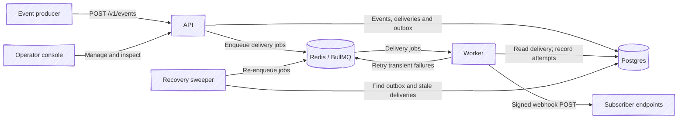
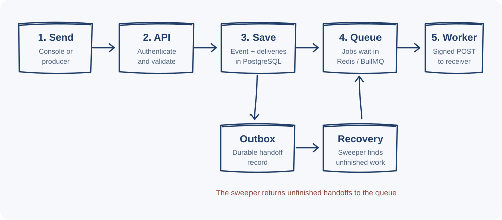

# Hikyaku

<p align="center">
  
</p>

Self-hosted, multi-tenant webhook delivery. Ingest an event once; the API fans it out to each active endpoint; the worker signs outbound HTTP with HMAC-SHA256, retries transient failures, and keeps attempt history in an operator console.

**Name:** 飛脚 (_hikyaku_) — Japan’s historic express couriers.

**Stack:** Node.js · Express · BullMQ · Postgres · Redis · Vite/React

**Repo:** [github.com/0x4Nayan04/Hikyaku](https://github.com/0x4Nayan04/Hikyaku) · **License:** [MIT](./LICENSE) · **Security:** [SECURITY.md](./SECURITY.md)

**Live demo:** [hikyaku.nayanswarnkar.com](https://hikyaku.nayanswarnkar.com) — public landing and docs. The operator console is invite-only (no self-serve signup). For a full console, follow [Local development](#local-development) below, or the [website](https://hikyaku.nayanswarnkar.com/docs#console-path) and [terminal](https://hikyaku.nayanswarnkar.com/docs#api-only-path) walkthroughs.

The demo configuration is **split**: web on Vercel, API + worker on Railway (`hikyakuapi.nayanswarnkar.com`). The proxy keeps session cookies on the Vercel origin. This describes repository configuration, not a live deployment check. **Self-host** with one-host Docker Compose — that is the supported path for your own install.

An optional [read-only console demo](deploy/README.md#read-only-console-demo) uses synthetic data and public credentials. Enable its login panel only after deploying enforcement and seeding the protected workspace.

**API reference:** [OpenAPI 3.1 source](docs/openapi.yaml) · [Published YAML](https://hikyaku.nayanswarnkar.com/openapi.yaml) (available after deploying this version). Sending events accepts an ingest API key or a signed-in workspace session. API-key ingest is stateless; session requests retain CSRF protection. Managing a workspace requires a session cookie. Production cookie mutations also require an allowlisted `Origin`.

## Architecture



The API stores each event, its deliveries, and their outbox entries in one Postgres transaction, then enqueues delivery jobs. The worker's sweeper recovers outbox entries and stale deliveries. Each active endpoint gets a separate delivery; receivers should deduplicate retries using `X-Webhook-Id`.

| Piece         | Role                                            |
| ------------- | ----------------------------------------------- |
| `apps/api`    | Auth, ingest, endpoints, deliveries, admin      |
| `apps/worker` | Signed outbound HTTP, retries, recovery sweeper |
| `apps/web`    | Landing, docs, operator console                 |
| Postgres      | Tenants, events, deliveries, attempts           |
| Redis         | BullMQ delivery queue                           |

## Local development

You need Node.js 22.22.2 or newer, pnpm 11.17.0 and Docker with Compose v2. Run these commands from the repository root:

```bash
corepack enable
pnpm install --frozen-lockfile
cp -n .env.example .env
```

Edit `.env` with local database and Redis settings and separate bootstrap and session secrets. Generate each secret with `openssl rand -hex 32`. Keep these values private and never commit them.

Start PostgreSQL and Redis, wait until both are healthy, then apply the migrations to the intended **local development database** and start the app:

```bash
docker compose up -d postgres redis
docker compose ps
(
  set -a
  . ./.env
  set +a
  pnpm db:migrate
)
pnpm dev
```

The migration changes the database schema. Check `DATABASE_URL` in `.env` points to the local development database before running it, and source only an environment file you control. The development Compose file publishes PostgreSQL on port 5432 and Redis on 6379.

Open the console at [localhost:5173](http://localhost:5173), the docs at [localhost:5173/docs](http://localhost:5173/docs), and the API at `http://localhost:3000`. For a deeper walkthrough, see the [in-app guide](http://localhost:5173/docs).

## Demo path (first run)

On a fresh local database:

1. Open [localhost:5173/bootstrap](http://localhost:5173/bootstrap) and enter `ADMIN_BOOTSTRAP_SECRET` from your local `.env`.
2. Create your account and first workspace, then sign in at `/login`.
3. Register a receiver in **Endpoints**. For a quick check, use [webhook.site](https://webhook.site) or a local receiver you control.
4. Open **Test event**, send the sample payload, and inspect the event and delivery timeline. The event being accepted is separate from the receiver successfully responding.

See the [console walkthrough](http://localhost:5173/docs#console-path) for the first event. Bootstrap is for first-time setup; existing installations use their existing account or an invitation. The optional development seed writes accounts and credentials and can close the first-user bootstrap path.


## Send an event

Use the console or HTTP commands. Register receivers, send events, inspect deliveries, and retry failures without opening the console.

The API key only **sends** events. Adding endpoints, creating keys, and replay use the console **or** a signed-in terminal session — see the walkthrough at [http://localhost:5173/docs#api-only-path](http://localhost:5173/docs#api-only-path) after `pnpm dev`.

With an active endpoint and a key:

```bash
curl -X POST "http://localhost:3000/v1/events" \
  -H "Authorization: Bearer whk_your_api_key" \
  -H "Content-Type: application/json" \
  -d '{
    "idempotency_key": "order-123-paid",
    "type": "order.paid",
    "payload": { "order_id": "123", "amount": 4999 }
  }'
```

`202 Accepted` means the ingest was accepted, not that every delivery succeeded. The response includes the event `id`; if no endpoints are active, its status is `no_recipients` and no delivery is queued. If enqueue fails after the event is committed, the API can return `503` while the outbox still enables later delivery. Retry the same request with the same idempotency key and inspect the event before sending a new one.

## Deploy

**Self-host (your own install):** one-host Docker Compose (API + worker + Postgres + Redis + Caddy).
See **[deploy/README.md](deploy/README.md)** for setup, HTTPS, backups, and upgrades.

**Public demo:** web on Vercel, API + worker on Railway. Same file, [Optional: Vercel + Railway](deploy/README.md#optional-vercel--railway).

## Project layout

```
apps/api         REST API — auth, ingest, deliveries, admin
apps/worker      Delivery worker (BullMQ)
apps/web         Operator console + docs
packages/shared  Schema, env, crypto, shared types
e2e/             Playwright smoke tests
deploy/          Production Compose stack + ops notes
```

### Follow your first event through the code



1. The [Test event page](apps/web/src/pages/events/SendEvent.tsx) validates the payload and calls the [web API client](apps/web/src/api/client.ts).
2. The [events route](apps/api/src/routes/events/index.ts) authenticates the request. Its [handler](apps/api/src/routes/events/handlers.ts) validates it and calls [fanout](apps/api/src/ingest/fanout.ts), which saves the event, deliveries and outbox entries in one database transaction.
3. The [publisher](apps/api/src/queue/publish.ts) adds delivery jobs to Redis. The [worker processor](apps/worker/src/processor.ts) signs the outgoing request and records its result.
4. The [sweeper](apps/worker/src/sweeper.ts) recovers unfinished handoffs and stale work. The console reads the stored event and delivery status.

The event is the message; a delivery is the attempt to send that message to one endpoint. If publishing fails after the database commit, the API can return `503` while the outbox retains work. Retry an uncertain request using the same idempotency key and body. Receivers must verify signatures and deduplicate with `X-Webhook-Id`.

## Verification

Run `pnpm lint`, `pnpm typecheck`, `pnpm test:unit` and `pnpm build`. Service-backed tests require explicit `TEST_DATABASE_URL` ending in `_test`, `TEST_REDIS_URL` with a database number greater than zero, and `TEST_RUN_ID`. Keep test resources separate from development and production; migrate only the isolated test database before running `pnpm test:integration`.

For local service-backed tests, create dedicated PostgreSQL and Redis containers. The example ports must be free; these containers are separate from the development Compose services:

```sh
docker run -d --name hikyaku-test-postgres -e POSTGRES_USER=hikyaku_test -e POSTGRES_PASSWORD=hikyaku_test -e POSTGRES_DB=hikyaku_test -p 127.0.0.1:5544:5432 postgres:16
docker run -d --name hikyaku-test-redis -p 127.0.0.1:6388:6379 redis:7
docker exec hikyaku-test-postgres pg_isready -U hikyaku_test -d hikyaku_test
docker exec hikyaku-test-redis redis-cli ping
```

Copy `.env.test.example` to a private file outside the checkout. If the destination already exists, inspect it privately and use it only if you control it. Restrict its permissions and check that its URLs point to these disposable services. In a dedicated shell, load that file, select a fresh run ID, and migrate the test database:

```sh
cp -n .env.test.example /tmp/hikyaku-local-tests.env
chmod 600 /tmp/hikyaku-local-tests.env
unset DATABASE_URL REDIS_URL
set -a
. /tmp/hikyaku-local-tests.env
set +a
export TEST_RUN_ID="local-$(date +%Y%m%d%H%M%S)"
DATABASE_URL="$TEST_DATABASE_URL" pnpm db:migrate
pnpm test:unit
pnpm test:integration
```

For onboarding smoke, use a fresh migrated test database with no users and the same isolated Redis instance. The browser harness starts its own API, worker, and web servers on ports 3101 and 5181; keep those ports free. Install Chromium with `pnpm exec playwright install chromium`, then run:

```sh
VITE_DEMO_LOGIN=true pnpm test:smoke e2e/00-onboarding.spec.ts e2e/dashboard.spec.ts e2e/read-only-demo.spec.ts
```

Stop the dedicated containers with `docker stop hikyaku-test-postgres hikyaku-test-redis` when finished. Do not reset or truncate a development or production database for tests.

## More detail

- [In-app guide](http://localhost:5173/docs): console and terminal walkthroughs, event flow and troubleshooting.

- [Deploy and ops](deploy/README.md): production hosting, backups, upgrades, and deployment configuration.

Local configuration examples live in `.env.example` and `.env.test.example`.
