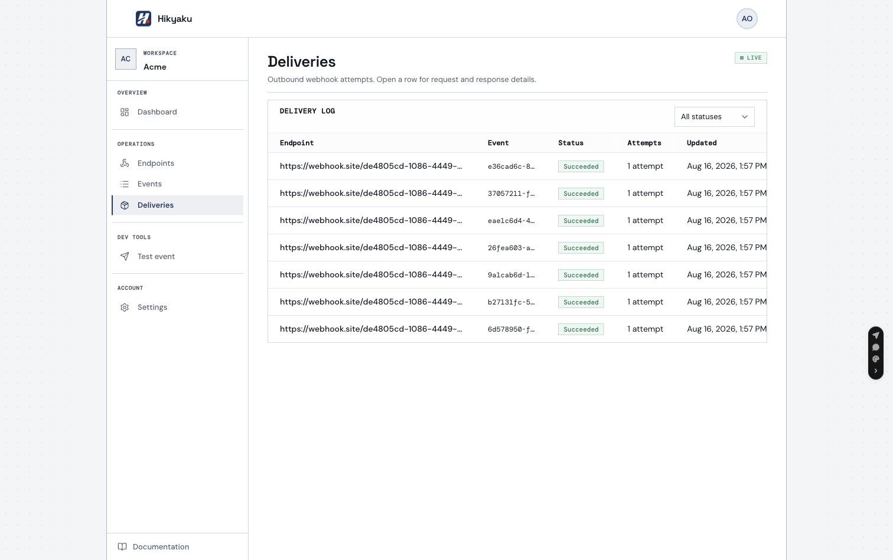

# Hikyaku

<p align="center">
  
</p>

Self-hosted, multi-tenant webhook delivery. Ingest an event once; the API fans it out to each active endpoint; the worker signs outbound HTTP with HMAC-SHA256, retries transient failures, and keeps attempt history in an operator console.

**Name:** 飛脚 (_hikyaku_) — Japan’s historic express couriers.

**Stack:** Node.js · Express · BullMQ · Postgres · Redis · Vite/React

**Repo:** [github.com/0x4Nayan04/Hikyaku](https://github.com/0x4Nayan04/Hikyaku) · **License:** [MIT](./LICENSE) · **Security:** [SECURITY.md](./SECURITY.md)

**Live demo:** [hikyaku.nayanswarnkar.com](https://hikyaku.nayanswarnkar.com) — public landing and docs. The operator console is invite-only (no self-serve signup). For a full console, follow [Local development](#local-development) below, or the [website](https://hikyaku.nayanswarnkar.com/docs#console-path) and [terminal](https://hikyaku.nayanswarnkar.com/docs#api-only-path) walkthroughs.

The hosted demo is **split**: web on Vercel, API + worker on Railway (`hikyakuapi.nayanswarnkar.com`). Session cookies stay on the Vercel origin. **Self-host** with one-host Docker Compose — that is the supported path for your own install.

## Architecture

```
Producer ──POST /v1/events──► API ──fan-out + enqueue──► Redis (BullMQ)
                                      │
                                      ▼
                                   Worker (sign + deliver + retry)
                                      │
                    ┌─────────────────┼─────────────────┐
                    ▼                 ▼                 ▼
              Endpoint A        Endpoint B        Endpoint C
           (HMAC-SHA256)         (backoff)       (attempt logs)
                                      │
                                      ▼
                               Postgres + console
```

| Piece | Role |
| --- | --- |
| `apps/api` | Auth, ingest, endpoints, deliveries, admin |
| `apps/worker` | Signed outbound HTTP, retries, recovery sweeper |
| `apps/web` | Landing, docs, operator console |
| Postgres | Tenants, events, deliveries, attempts |
| Redis | BullMQ delivery queue |

## Local development

Needs Node.js 22 (`nvm use` / `.nvmrc`; use **22.22.2+** so locked test deps match CI), [pnpm](https://pnpm.io/) **11.17.0**, and Docker (Postgres 16 + Redis 7).

```bash
git clone https://github.com/0x4Nayan04/Hikyaku.git
cd Hikyaku
cp .env.example .env
corepack enable
pnpm install
pnpm docker:up
pnpm db:migrate
pnpm dev
```

| Surface | URL |
| --- | --- |
| Landing / console | http://localhost:5173 |
| Docs | http://localhost:5173/docs |
| API | http://localhost:3000 |

## Demo path (first run)

1. Open http://localhost:5173/bootstrap and enter `ADMIN_BOOTSTRAP_SECRET` from `.env`.
2. Create the installer account and first workspace, then sign in at `/login`.
3. On **Dashboard**, add an endpoint (or use [webhook.site](https://webhook.site)), send a test event, and open **Deliveries**.

Optional local seed (two demo tenants + printed API keys; never for production):

```bash
pnpm db:seed
```



## Send an event

Use the console or HTTP commands. Register receivers, send events, inspect deliveries, and retry failures without opening the console.

The API key only **sends** events. Adding endpoints, creating keys, and replay use the console **or** a signed-in terminal session — see the walkthrough at [http://localhost:5173/docs#api-only-path](http://localhost:5173/docs#api-only-path) after `pnpm dev`.

With an active endpoint and a key:

```bash
curl -X POST "http://localhost:3000/v1/events" \
  -H "Authorization: Bearer whk_your_api_key" \
  -H "Content-Type: application/json" \
  -d '{
    "idempotency_key": "order-123-paid",
    "type": "order.paid",
    "payload": { "order_id": "123", "amount": 4999 }
  }'
```

`202 Accepted` means the event is queued, not that every delivery succeeded. The response includes the event `id`.

## Deploy

**Self-host (your own install):** one-host Docker Compose (API + worker + Postgres + Redis + Caddy).
See **[deploy/README.md](deploy/README.md)** for setup, HTTPS, backups, and upgrades.

**Public demo:** web on Vercel, API + worker on Railway. Same file, [Optional: Vercel + Railway](deploy/README.md#optional-vercel--railway).

## Project layout

```
apps/api         REST API — auth, ingest, deliveries, admin
apps/worker      Delivery worker (BullMQ)
apps/web         Operator console + docs
packages/shared  Schema, env, crypto, shared types
e2e/             Playwright smoke tests
deploy/          Production Compose stack + ops notes
```

## More detail

Environment variables, delivery guarantees, health checks, scripts, and safe test setup live in **[deploy/README.md](deploy/README.md)** (ops & reference) and `.env.example` / `.env.test.example`.
