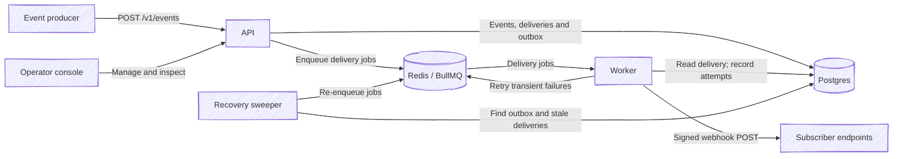
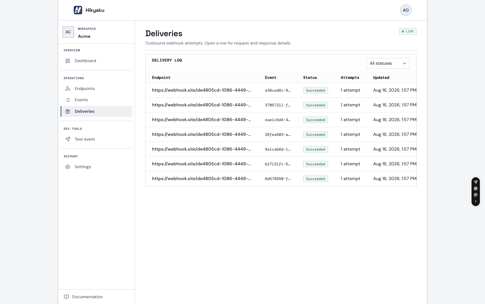

# Hikyaku

<p align="center">
  
</p>

Self-hosted, multi-tenant webhook delivery. Ingest an event once; the API fans it out to each active endpoint; the worker signs outbound HTTP with HMAC-SHA256, retries transient failures, and keeps attempt history in an operator console.

**Name:** 飛脚 (_hikyaku_) — Japan’s historic express couriers.

**Stack:** Node.js · Express · BullMQ · Postgres · Redis · Vite/React

**Repo:** [github.com/0x4Nayan04/Hikyaku](https://github.com/0x4Nayan04/Hikyaku) · **License:** [MIT](./LICENSE) · **Security:** [SECURITY.md](./SECURITY.md)

**Live demo:** [hikyaku.nayanswarnkar.com](https://hikyaku.nayanswarnkar.com) — public landing and docs. The operator console is invite-only (no self-serve signup). For a full console, follow [Local development](#local-development) below, or the [website](https://hikyaku.nayanswarnkar.com/docs#console-path) and [terminal](https://hikyaku.nayanswarnkar.com/docs#api-only-path) walkthroughs.

The hosted demo is **split**: web on Vercel, API + worker on Railway (`hikyakuapi.nayanswarnkar.com`). Session cookies stay on the Vercel origin. **Self-host** with one-host Docker Compose — that is the supported path for your own install.

An optional [read-only console demo](deploy/README.md#read-only-console-demo) uses synthetic data and public credentials. Enable its login panel only after deploying enforcement and seeding the protected workspace.

**API reference:** [OpenAPI 3.1 source](docs/openapi.yaml) · [Published YAML](https://hikyaku.nayanswarnkar.com/openapi.yaml) (available after deploying this version). Sending events accepts an ingest API key; managing a workspace requires a session cookie. Production cookie mutations also require an allowlisted `Origin`.

## Architecture



The API stores each event, its deliveries, and their outbox entries in one Postgres transaction, then enqueues delivery jobs. The worker's sweeper recovers outbox entries and stale deliveries. Each active endpoint gets a separate delivery; receivers should deduplicate retries using `X-Webhook-Id`.

| Piece         | Role                                            |
| ------------- | ----------------------------------------------- |
| `apps/api`    | Auth, ingest, endpoints, deliveries, admin      |
| `apps/worker` | Signed outbound HTTP, retries, recovery sweeper |
| `apps/web`    | Landing, docs, operator console                 |
| Postgres      | Tenants, events, deliveries, attempts           |
| Redis         | BullMQ delivery queue                           |

## Local development

Needs Node.js 22 (`nvm use` / `.nvmrc`; use **22.22.2+** so locked test deps match CI), [pnpm](https://pnpm.io/) **11.17.0**, and Docker (Postgres 16 + Redis 7).

```bash
git clone https://github.com/0x4Nayan04/Hikyaku.git
cd Hikyaku
cp .env.example .env
corepack enable
pnpm install
pnpm docker:up
pnpm db:migrate
pnpm dev
```

| Surface           | URL                        |
| ----------------- | -------------------------- |
| Landing / console | http://localhost:5173      |
| Docs              | http://localhost:5173/docs |
| API               | http://localhost:3000      |

## Demo path (first run)

1. Open http://localhost:5173/bootstrap and enter `ADMIN_BOOTSTRAP_SECRET` from `.env`.
2. Create the installer account and first workspace, then sign in at `/login`.
3. On **Dashboard**, add an endpoint (or use [webhook.site](https://webhook.site)), send a test event, and open **Deliveries**.

Optional local seed (two demo tenants + printed API keys; never for production):

```bash
pnpm db:seed
```



## Send an event

Use the console or HTTP commands. Register receivers, send events, inspect deliveries, and retry failures without opening the console.

The API key only **sends** events. Adding endpoints, creating keys, and replay use the console **or** a signed-in terminal session — see the walkthrough at [http://localhost:5173/docs#api-only-path](http://localhost:5173/docs#api-only-path) after `pnpm dev`.

With an active endpoint and a key:

```bash
curl -X POST "http://localhost:3000/v1/events" \
  -H "Authorization: Bearer whk_your_api_key" \
  -H "Content-Type: application/json" \
  -d '{
    "idempotency_key": "order-123-paid",
    "type": "order.paid",
    "payload": { "order_id": "123", "amount": 4999 }
  }'
```

`202 Accepted` means the ingest was accepted, not that every delivery succeeded. The response includes the event `id`; if no endpoints are active, its status is `no_recipients` and no delivery is queued. If enqueue fails after the event is committed, the API can return `503` while the outbox still enables later delivery. Retry the same request with the same idempotency key and inspect the event before sending a new one.

## Deploy

**Self-host (your own install):** one-host Docker Compose (API + worker + Postgres + Redis + Caddy).
See **[deploy/README.md](deploy/README.md)** for setup, HTTPS, backups, and upgrades.

**Public demo:** web on Vercel, API + worker on Railway. Same file, [Optional: Vercel + Railway](deploy/README.md#optional-vercel--railway).

## Project layout

```
apps/api         REST API — auth, ingest, deliveries, admin
apps/worker      Delivery worker (BullMQ)
apps/web         Operator console + docs
packages/shared  Schema, env, crypto, shared types
e2e/             Playwright smoke tests
deploy/          Production Compose stack + ops notes
```

## Verification

Run the static checks from the workspace root:

```sh
pnpm typecheck
pnpm lint
```

API, worker, and browser tests require isolated Postgres and Redis resources. The
test database name must end in `_test`, the Redis URL must select a dedicated
database number greater than zero, and `TEST_RUN_ID` must be unique to the run.
Provision these resources separately; the normal development Compose services are
not isolated test resources. For example, edit `~/.hikyaku-test.env` to point at your test
services, then export it in the shell (the test runners do not load it for you):

```sh
cp -n .env.test.example ~/.hikyaku-test.env
chmod 600 ~/.hikyaku-test.env
# Edit ~/.hikyaku-test.env with your isolated test database and Redis URLs first.
set -a
. ~/.hikyaku-test.env
set +a
unset DATABASE_URL REDIS_URL
export TEST_RUN_ID="local-$(date +%s)"
pnpm --filter @hikyaku/shared build
DATABASE_URL="$TEST_DATABASE_URL" pnpm db:migrate
pnpm test:unit
pnpm test:integration
pnpm test:smoke
```

The smoke suite starts its own API, worker, and web servers; it requires the
Playwright Chromium browser. See [safe tests](deploy/README.md#safe-tests) for
details. Keep test credentials separate from development and production.

The API integration cases are grouped by auth, tenancy, events, delivery, and
platform behavior. Lifecycle tests use controlled collaborators; the worker retry
integration also verifies a real BullMQ job retries automatically after HTTP 503.

## More detail

Environment variables, delivery guarantees, health checks, scripts, and safe test setup live in **[deploy/README.md](deploy/README.md)** (ops & reference) and `.env.example` / `.env.test.example`.
