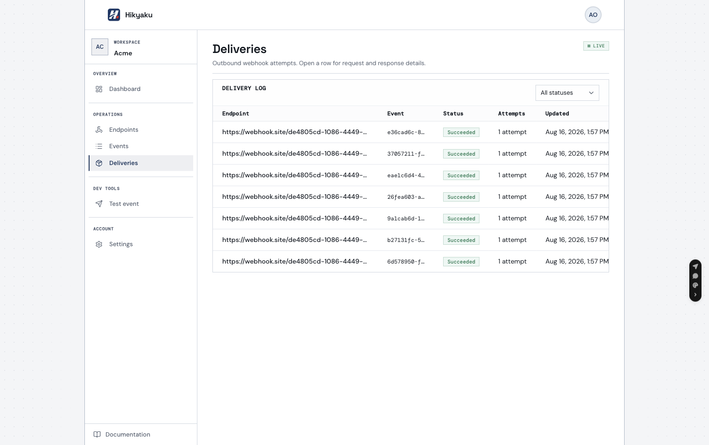
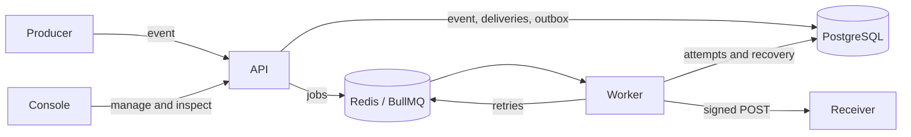

# Hikyaku

Hikyaku is a self-hosted webhook delivery system for multiple workspaces. It accepts events, sends signed HTTP requests to registered endpoints, retries transient failures, and records delivery attempts.

- Send events from a producer using an ingest API key or a signed-in session.
- Manage endpoints, keys, events and deliveries in the console.
- Inspect delivery attempts and replay eligible deliveries.
- Verify outbound requests with HMAC-SHA256 and deduplicate retries using `X-Webhook-Id`.



## Architecture



The API commits the event, deliveries and outbox entries together. A worker processes queued deliveries and recovers unfinished work. An accepted event is not proof of successful delivery. See the [docs](https://hikyaku.nayanswarnkar.com/docs) and [OpenAPI reference](docs/openapi.yaml).

The workspace uses Node.js, TypeScript, Express, React, PostgreSQL, Redis and BullMQ.

## Quickstart

Install Node.js 22.22.2 or newer, pnpm 11.17.0, and Docker with Compose v2. From the repository root:

```bash
corepack enable
pnpm install --frozen-lockfile
cp -n .env.example .env
```

Edit `.env` for your local database and Redis, and set separate bootstrap and session secrets. Generate each secret with `openssl rand -hex 32`. Keep secrets private. Before migrating, confirm `DATABASE_URL` points to your local development database.

```bash
docker compose up -d postgres redis
docker compose ps
(
  set -a
  . ./.env
  set +a
  pnpm db:migrate
)
pnpm dev
```

Open [localhost:5173](http://localhost:5173) and visit `/bootstrap` on a fresh database to create the first account. Sign in, add a receiver under **Endpoints**, then use **Test event** and inspect the delivery. The [local guide](http://localhost:5173/docs) contains terminal and console walkthroughs.

## Project structure

| Path                | Purpose                                      |
| ------------------- | -------------------------------------------- |
| `apps/api`          | HTTP API, authentication and event ingestion |
| `apps/worker`       | Delivery, retries and recovery               |
| `apps/web`          | Console, public site and docs                |
| `packages/shared`   | Database schema and shared contracts         |
| `docs/openapi.yaml` | HTTP API reference                           |
| `deploy`            | Self-hosting and operations guide            |
| `e2e`               | Playwright smoke tests                       |

## Common commands

Run these from the repository root.

| Command                 | Purpose                                                        |
| ----------------------- | -------------------------------------------------------------- |
| `pnpm dev`              | Start API, worker and web development servers                  |
| `pnpm build`            | Build workspace packages                                       |
| `pnpm lint`             | Run ESLint                                                     |
| `pnpm typecheck`        | Check TypeScript projects                                      |
| `pnpm test:unit`        | Run unit tests                                                 |
| `pnpm test:integration` | Run API and worker integration tests against isolated services |
| `pnpm db:migrate`       | Apply database migrations                                      |
| `pnpm test:smoke`       | Run Playwright smoke tests                                     |

Integration and smoke tests require a disposable PostgreSQL database and Redis instance. See [safe test setup](deploy/README.md#safe-tests); never point them at production data.

## Configuration

The complete local examples are in [`.env.example`](.env.example) and [`.env.test.example`](.env.test.example). Values are not included here.

| Variable                 | Purpose                                        |
| ------------------------ | ---------------------------------------------- |
| `DATABASE_URL`           | PostgreSQL connection                          |
| `REDIS_URL`              | Redis connection                               |
| `ADMIN_BOOTSTRAP_SECRET` | Authorizes first-account bootstrap             |
| `SESSION_SECRET`         | Signs session cookies                          |
| `CORS_ORIGIN`            | Allowed browser origins                        |
| `WEB_APP_URL`            | Base URL for generated links                   |
| `VITE_API_URL`           | Browser API base at web build time             |
| `WORKER_CONCURRENCY`     | Number of delivery jobs processed concurrently |

## Deployment and contributing

See [deploy/README.md](deploy/README.md) for self-hosting, backups, upgrades and operational configuration. For changes, run the relevant checks above and include tests where behavior changes. Report security issues as described in [SECURITY.md](SECURITY.md).

Hikyaku is available under the [MIT license](LICENSE).
