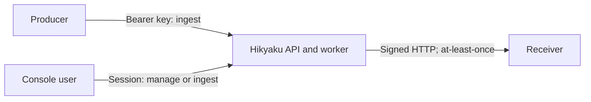
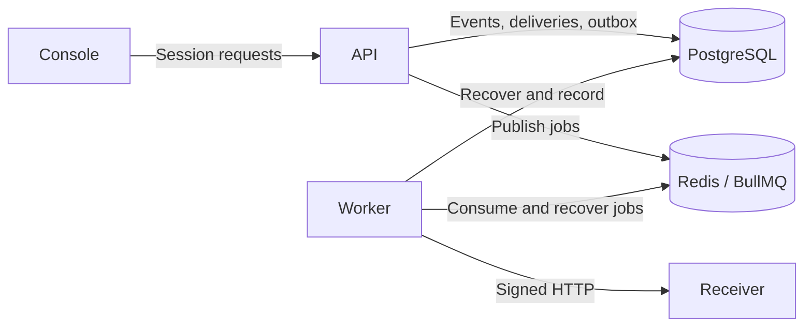
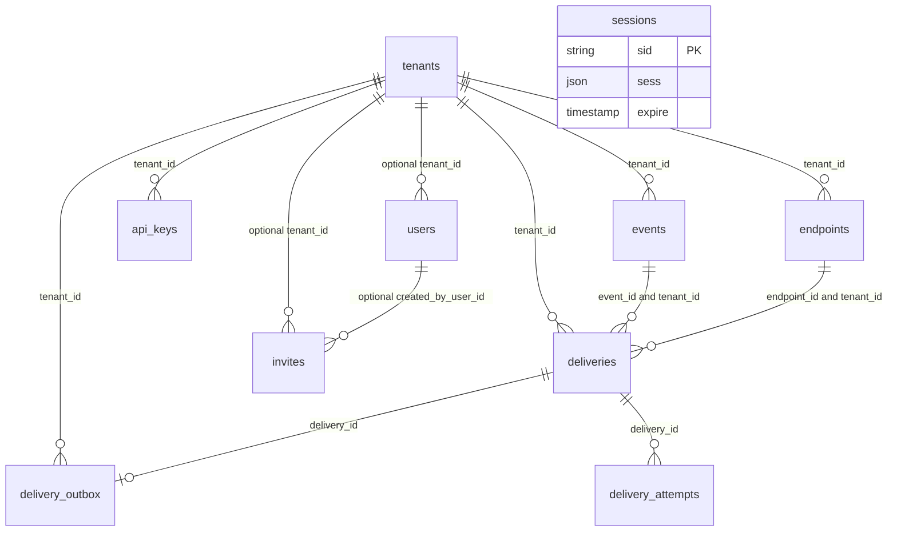

# Architecture diagrams

Mermaid sources describe the current API, worker and database contracts. The public docs use matching, manually authored SVG diagrams so visitors do not need a diagram runtime.

## System context



## Components



## Ingest and recovery

```mermaid
sequenceDiagram
  participant C as Client
  participant A as API
  participant D as PostgreSQL
  participant Q as Redis / BullMQ
  participant W as Worker
  participant R as Receiver
  C->>A: POST /v1/events (key or session)
  A->>D: Transaction: event, deliveries, outbox
  Note over D: No active endpoints: no_recipients, zero deliveries
  A->>Q: Publish jobs after commit
  alt Queue accepts
    A->>D: Delete outbox rows
    A-->>C: 202 accepted
  else Publish fails
    A-->>C: 503; transaction may be committed
    W->>D: Sweeper reads outbox
    W->>Q: Republish jobs
    W->>D: Delete outbox after enqueue
  end
  Q->>W: Delivery job
  W->>R: Signed HTTP (at-least-once)
  W->>D: Record outcome / attempt
```

## Data model



